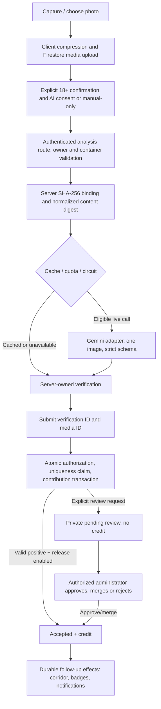

# Image verification v2 — implementation and release notes

**Baseline:** Latest `PatchUpUIRedesign (2).zip`, containing the original pre-Phase-1 Gemini adapter, not the flawed Antigravity Phase 1 archive. Rebuilt selectively; no old private credentials or dependencies are distributed. Date: 2026-11-24.

## 1. Design and flow

- `server/verificationPolicy.ts`: strict observation (`category`, `quality`, `visibleCavity`), decision policy, release and expiry gate. No model confidence score is used for acceptance. Severity remains unclassified pending human review. Model defaults to `gemini-3.5-flash-lite`; no silent model fallback.
- `server/imageBytes.ts`: bounded JPEG/PNG/WebP container parsing, actual size/dimension checks, metadata stripping, original and normalized SHA-256. No external image decoder introduced. Rejects wrong MIME, unsupported/animated encoding, truncated containers and trailing bytes. This is not a full decoder or steganography detector. It cannot redact visible personal information.
- `server/gemini.ts`: provider adapter uses `@google/genai`, one compressed image, no user notes, coordinates, candidate photo or user ID; strict response schema and independent validation. Server-generated display text avoids storing hallucinated free-text PII. Abort signal and 15-second client-side deadline; provider-side processing/charges may continue after abort. No unbounded retry.
- `server/verification.ts`: server-owned record, per-owner normalized content cache, atomic shared call reservation, pending lease (60s), 24h success cache, 30s failure cooldown, circuit break for quota/repeated failures. Default 200 attempted calls/day globally, 20/user/day, 10/min globally. Configurable, UTC. Manual review bypasses provider calls, not the authorization checks. Existing Express IP/UID throttles also apply; shared proxy IPs may require deployment-specific trusted proxy configuration.
- `server/submission.ts`: actual transactional core, called only after authenticated routes validate inputs. Original bytes, owner, media ID, record version, expiry, completed state, decision, gate and single-use verification checked; pending records cannot approve. A global content claim prevents identical normalized photo replay across accounts and new media IDs. Durable 25 submissions/user/day default includes manual review. Reads precede writes. No provider calls in transactions. Existing ID retries must match owner, image, verification, intended action, target and coordinates. GPS/EXIF/manual pin authenticity is not proven by the photo classifier.
- `server/contributions.ts`: approval transaction writes user counts/streak, leaderboard period/overall counts, unique feed event and durable effects record together. Admin approval/merge/rejection updates pending submission and canonical state with an audit record in the same transaction. Retried or competing approvals cannot award core credit twice. Post-commit corridor/badge/notification work is retryable; `POST /api/admin/contributions/reconcile` processes up to 25 pending effects. Existing badge/corridor notification logic has remaining concurrency and retry limitations; see below.
- `server/segments.ts`: fixed a read-after-write ordering issue in the five-pothole threshold path. Direct admin status editing cannot promote an unreviewed or rejected record; dedicated review path owns approval. Actual threshold and segment concurrency require emulator validation.
- `server.ts`: no trusted client AI flags, no optional arbitrary candidate-media analysis, no public REST fallback for media, exact ownership, sanitized provider failures, no legacy hardcoded admin email list. The old self-resolution route is admin-only. Geo candidate detection remains, but candidates must be accepted and merges must target an accepted record within 25m, with the existing evidence cap.
- `CaptureView.tsx`: explicit AI consent or manual-only check, age attestation, authoritative decision states, retry/appeal, request generation guards, current photo binding. Pending review is visible to contributor on Home and administrators, not the public map. Existing admin interface has an explicit Approve photo action and preserves target evidence intent. Removed unsafe user self-approval. `ProtectedImage.tsx` uses token-authenticated image fetch for private previews; approved referenced photos remain public. No layout/style redesign or new framework.

## 2. API contracts

### `POST /api/potholes/analyze`
Verified Firebase bearer token. JSON `{ "mediaId": "med_...", "ageConfirmed": true, "aiConsent": true }` (set `aiConsent:false` for manual-only). The endpoint never reads client-supplied notes, candidate photo, hash or model. Age is self-attested, not proof of identity or verified age.

Success JSON includes `verificationId`, `mediaId`, `verificationState` (`completed`/`unavailable`), `classificationDecision` (`verified`/`not_pothole`/`needs_review`/null), `available`, `model`, `summary`, `expiresAtMs` and sanitized compatibility fields. The displayed decision is `needs_review` when a positive candidate observation is not eligible for auto-acceptance. Busy requests return 409; local throttling returns 429. Failure does not create an affirmative observation. If persistence fails, no valid verification ID is returned.

### `POST /api/potholes/submit`
Verified Firebase bearer token. Existing location and submission fields plus `verificationId`. `actionType` is `new_pothole`, `add_evidence` or `provisional_review`. The latter is explicit review consent and can carry an intended `targetPotholeId` for later evidence merge. Nonaffirmative/disabled-gate submissions cannot use the automatic actions. Verification result must match owner/media/version/content and be unconsumed. HTTP 201 includes `submissionId`, `potholeId`, `duplicateStatus`, `idempotent` and optional segment result. Never trust `aiClassificationStatus`, `aiIsRoadDefect`, `aiSeverityLabel` or `aiSummary` from clients.

### Review and media
- `POST /api/admin/potholes/:id/review` existing admin route now uses the atomic pending review pathway for approval/rejection. For pending intended evidence, approval merges into its target if still eligible; otherwise it fails rather than silently creating a distinct contribution.
- `POST /api/submissions/:id/resolve` admin-only: `resolution` is `confirm_distinct`, `merge_evidence`, or `reject`, optional target and reason. Core credit is atomic. Rejected pending submissions are terminal; retry returns prior outcome.
- `POST /api/admin/contributions/reconcile` admin-only: process pending secondary effects. Core credit is never repeated. Monitor failures.
- `GET /api/media/:id` returns bytes to the authenticated owner/verified administrator or an accepted canonical/evidence reference or the owner's own published avatar. No public access to unsubmitted or pending images. No public cache for media. Existing accepted photographs are intentionally public; don't upload identifying imagery.

## 3. Firestore data and retention

| Collection | Purpose | Retention / access |
|---|---|---|
| `imageVerifications` | Owner/media/digests, provider/version, validated observation, decision, expiry, consumed submission | Server only; 24h validity, TTL field `expiresAt` |
| `imageAnalysisCache` | Owner-scoped normalized-content and version cache, result/lease/cooldown | Server only; 24h success validity; TTL field `expiresAt` |
| `verificationBudgets` | Durable UTC day/minute/user counters, circuit, daily submission counter | Server only; dated docs expire after ~2 days; circuit excluded from TTL |
| `imageClaims` | Exact normalized-photo uniqueness and original digest binding to submission/media | Server only; durable; don't TTL blindly or replay protection disappears |
| `contributionEffects` | Accepted submission secondary work and core credit marker | Server only; durable; admin retries pending effects |
| `mediaRetired` | Tombstones prevent reusing retired IDs | Server only; durable |

`firestore.rules` enforces default-deny for these collections and prohibits direct client mutation/deletion of existing media. Rules require bytes size to match declared size. Public pothole queries use accepted statuses only. New private records are removed in paginated account cleanup; approved community media are anonymized/retained, private/abandoned media retired on account deletion. This is not a legal compliance certification. Firestore TTL policies are **not enabled by this package**; review billing and configure TTL for `expiresAt` on the first three collections, or run authorized maintenance. Logical expiry works regardless of TTL. Establish a scheduled review of orphan/unsubmitted images and retention of audit/claim data; no background cleanup job is installed. Claims intentionally remain after account deletion to prevent replay and must be considered in retention/privacy policy.

## 4. Operational settings

Use `.env.example`. `PATCHUP_IMAGE_AI_ENABLED=false` by default, `PATCHUP_AUTO_ACCEPT=false` by default. A matching `PATCHUP_BENCHMARK_APPROVED_VERSION` (`model|pothole-visual-v2|2`) is required as well as both switches. This is an operator-controlled release interlock. Do not use a manually guessed marker as evidence of accuracy. Use [benchmark protocol](BENCHMARK.md). Actual quotas and model availability must be checked in your project. The previous discussion recommended non-sensitive free-tier testing and paid production if eligible. Do not enable live user AI processing until the team has reviewed current provider terms, privacy, age eligibility and billing. Self-attestation does not guarantee age compliance. No automatic face/plate redaction; avoid capturing personal details, clearly disclose third-party processing and public visibility.

Default budgets cap attempts, not exact dollar spend. API cancellations may still incur usage, and Firestore reads/writes, hosting and Maps have separate quotas. Configure project-side limits/alerts. A budget alert is not a spending cap. `GET /api/health` includes the resolved model and AI/gate flags without returning the API key.

## 5. Testing evidence from this build environment

- **PASS:** TypeScript `tsc --noEmit` using available global TypeScript 5.8.3 and the extracted dependency type files from the earlier supplied Mac archive. The exact lockfile-native TS 7 compiler could not run in Linux.
- **PASS:** `node node_modules/eslint/bin/eslint.js firestore.rules` using extracted dependencies (static rules lint, not rules emulator enforcement).
- **PASS:** regression and verification tests with the Node test runner, see `docs/test-results.txt`. New tests execute the real submission/review functions with a strict staged, serialized database double enforcing reads-before-writes and rollback. Simultaneous requests in this double establish single-credit behavior under serialized operations, not real Firestore conflict/retry semantics.
- **BLOCKED:** exact `npm ci`/production Vite build in this environment. Earlier supplied dependencies contain Darwin ARM64 native binaries; Linux native Rolldown and TS packages unavailable, npm registry DNS failed. No build pass is claimed. Package lock/dependency versions were not changed; install fresh on Antigravity.
- **NOT TESTED:** local real Firestore emulator (opt-in test included), client security-rules enforcement, full authenticated HTTP integration, browser UI/visual regression, actual Firebase deployment, actual Gemini calls or accuracy benchmark after changes. No credentials were used or requested, no cloud resources changed. Synthetic parser fixtures are not pothole accuracy samples.

## 6. Release checklist and limitations

1. Fresh install on Antigravity and run `npm run lint`, `npm run lint:rules`, `npm test`, `npm run build`. Fix any environment-specific problems; confirm correct Firebase project/database/rotated keys. Preserve the existing font from your original project if licensed (font binary not redistributed).
2. Create a **separate staging database/project**. Review `firebase.json` and match the named database. For an isolated demo emulator, start `firebase emulators:start --only firestore --project demo-patchup-verification` after installing Firebase CLI/Java. Set `FIRESTORE_EMULATOR_HOST=127.0.0.1:8080` and run `npm run test:emulator`; it uses a dedicated demo project and default database, and does not exercise client rules. Clear its disposable data between runs. Separately test actual client Firestore rules (owner/non-owner, unauthenticated media get, denied server collection writes, denied pending list and delete/recreate), real authenticated HTTP paths, concurrent submissions and fifth-pothole threshold. The package has not tested these against a real emulator.
3. Deploy matched server, frontend and rules together in staging. Older clients lacking `verificationId` will receive a rejection; force a PWA reload. Deploy rules to the correct **named database** only after reviewing existing rules and indexes; never blindly replace live indexes or use force flags. Test staged routes before promoting. Do not deploy static `dist` alone.
4. Perform the 50-image pilot and held-out 500-image benchmark from `BENCHMARK.md`. Confirm eligible provider terms, billing, disclosure and age policy. Run controlled beta with auto-accept disabled; review queue capacity and latency. Enable release gate only after sign-off and verification. If model/prompt/schema changes, the approved version no longer matches.
5. Before production, audit existing data. The exact-content claims ledger covers new submissions and legacy pending records processed through the new admin review path, not all historically accepted photos. Backfill approved historical claims after identifying duplicates (avoid assigning arbitrary winners); existing accepted content is not automatically reclassified, and pre-existing malformed/deleted-contributor media may need repair. Review old counters and missing leaderboard period data. No destructive migration or automatic backfill is performed. Older anonymized media whose owner ID was not anonymized can become inaccessible until reconciled.
6. Monitor pending effects, cache growth, quotas and provider errors. Keep the admin queue staffed; disable AI/gate immediately if accuracy or privacy issues arise. `PATCHUP_AUTO_ACCEPT=false` disables automatic contributions without disabling manual review. For rollback, retain the secure server/rules or disable submissions while rolling back; do **not** restore the old client-trusting endpoint to public traffic. Preserve claim records and backup database before deployment.

### Remaining boundaries

- Exact normalized digest prevents byte-identical or metadata-only duplicate reuse; re-encoding, crop/resize, edited/synthetic pictures and different photos of the same pothole can evade it. Geographic matching is advisory; manually verify distinct locations. The classifier cannot prove photo freshness, provenance, GPS or severity. Additional perceptual hashing/duplicate evidence may be evaluated later.
- Core user/leaderboard/feed credit is atomic. Existing corridor grouping and achievement/notification routines are secondary and retryable but not fully transactional across all operations; possible duplicate segment creation, missed badge/repair notifications or stale badge progress require staging tests/reconciliation. Rejection of previously accepted legacy contributions does not reverse all historical counters automatically; audit/recount policy remains a separate task. Account deletion is not globally transactional with concurrent operations.
- Bounded parser does not fully decode image pixels, validate every image CRC or remove hidden data embedded in pixel content. Visible PII and manipulated imagery remain possible. No redaction subsystem or age identity verification is implemented. Private image retention and broader privacy/legal policies still need owner approval.
- Public media access queries can add Firestore read cost. Test realistic map/gallery loads and proxy rate limits. There is no active scheduled job, no external data export, and no automatic deployment.
- Figma visual refinement is a later human workflow. Source layout and original visual assets were retained except the unredistributed font; explicit capture consent/review states, admin approval controls and hiding pending map pins are intentional functional UI changes. No pixel-diff visual verification was possible here.
