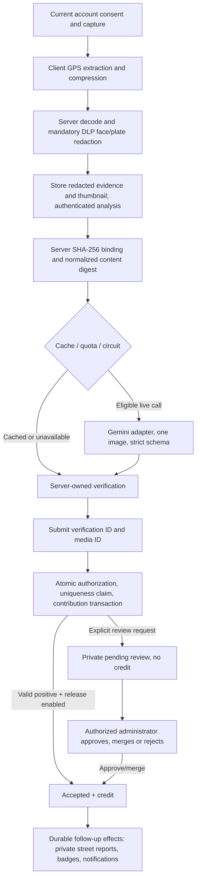

# Image verification — current release

Current release: `gemini-3.5-flash-lite|atldot-pothole-v3-pixel-redacted-v1|3`. Previous approval markers do not authorize this release.

## 1. Design and flow

- `server/verificationPolicy.ts`: strict observation (`category`, `quality`, `visibleCavity`), decision policy, release and expiry gate. No model confidence score is used for acceptance. Severity remains unclassified pending human review. Model defaults to `gemini-3.5-flash-lite`; no silent model fallback.
- `server/imageBytes.ts`: bounded JPEG/PNG/WebP container parsing, actual size/dimension checks, metadata stripping, original and normalized SHA-256. Sharp/libvips additionally decodes and re-encodes the image; DLP redaction is mandatory before pothole storage. Rejects wrong MIME, unsupported/animated encoding, truncated containers and trailing bytes. This is not a full decoder or steganography detector. The parser alone cannot redact visible personal information.
- `server/gemini.ts`: provider adapter uses `@google/genai`, one compressed image, no user notes, coordinates, candidate photo or user ID; strict response schema and independent validation. Server-generated display text avoids storing hallucinated free-text PII. Abort signal and 15-second client-side deadline; provider-side processing/charges may continue after abort. No unbounded retry.
- `server/verification.ts`: server-owned record, per-owner normalized content cache, atomic shared call reservation, pending lease (60s), 24h success cache, 30s failure cooldown, circuit break for quota/repeated failures. Fixed ceilings: 100/day, 3000/month, 10/min globally, 25/day and 3/min per user. Lower settings allowed; invalid settings fail closed. UTC. Manual review can use an eligible existing verification record without a second provider call; it still requires authorization. Existing Express IP/UID throttles also apply; shared proxy IPs may require deployment-specific trusted proxy configuration.
- `server/submission.ts`: actual transactional core, called only after authenticated routes validate inputs. Original bytes, owner, media ID, record version, expiry, completed state, decision, gate and single-use verification checked; pending records cannot approve. A global content claim prevents identical normalized photo replay across accounts and new media IDs. Durable 25 submissions/user/day default includes manual review. Reads precede writes. No provider calls in transactions. Existing ID retries must match owner, image, verification, intended action, target and coordinates. GPS/EXIF/manual pin authenticity is not proven by the photo classifier.
- `server/contributions.ts`: approval transaction writes user counts/streak, leaderboard period/overall counts, unique feed event and durable effects record together. Admin approval/merge/rejection updates pending submission and canonical state with an audit record in the same transaction. Retried or competing approvals cannot award core credit twice. Post-commit street grouping/badge/notification work is retryable; `POST /api/admin/contributions/reconcile` processes up to 25 pending effects. Existing badge/street grouping logic has remaining concurrency and retry limitations; see below.
- `server/segments.ts`: fixed a read-after-write ordering issue in the five-pothole threshold path. Direct admin status editing cannot promote an unreviewed or rejected record; dedicated review path owns approval. Actual threshold and segment concurrency require emulator validation.
- `server.ts`: no trusted client AI flags, no optional arbitrary candidate-media analysis, no public REST fallback for media, exact ownership, sanitized provider failures, no legacy hardcoded admin email list. The old self-resolution route is admin-only. Geo candidate detection remains, but candidates must be accepted and merges must target an accepted record within 25m, with the existing evidence cap.
- `CaptureView.tsx`: stored versioned account consent, privacy review, automatic photo check, authoritative decision states, retry/appeal, request generation guards, current photo binding. Pending review is visible to contributor on Home and administrators, not the public map. Existing admin interface has an explicit Approve photo action and preserves target evidence intent. Removed unsafe user self-approval. `ProtectedImage.tsx` uses token-authenticated image fetch for private previews; approved referenced redacted photos may be public. No layout/style redesign or new framework.

## 2. API contracts

### `POST /api/potholes/analyze`
Verified Firebase bearer token. JSON `{ "mediaId": "med_..." }`. The endpoint requires current stored account consent, Cloud Run redaction, paid Gemini mode and image AI activation. The endpoint never reads client-supplied notes, candidate photo, hash or model. Age is self-attested, not proof of identity or verified age.

Success JSON includes `verificationId`, `mediaId`, `verificationState` (`completed`/`unavailable`), `classificationDecision` (`verified`/`not_pothole`/`needs_review`/null), `available`, `model`, `summary`, `expiresAtMs` and sanitized compatibility fields. The displayed decision is `needs_review` when a positive candidate observation is not eligible for auto-acceptance. Busy requests return 409; local throttling returns 429. Failure does not create an affirmative observation. If persistence fails, no valid verification ID is returned.

### `POST /api/potholes/submit`
Verified Firebase bearer token. Existing location and submission fields plus `verificationId`. `actionType` is `new_pothole`, `add_evidence` or `provisional_review`. The latter is explicit review consent and can carry an intended `targetPotholeId` for later evidence merge. Nonaffirmative or auto-accept-disabled submissions cannot use the automatic actions. A new manual-review submission still requires a valid server-issued verification ID. With image AI or paid mode disabled, analysis returns HTTP 503 before issuing that ID, so a newly uploaded photo cannot currently enter manual review from Capture. This is a release limitation, not a supported manual-only configuration. Verification result must match owner/media/version/content and be unconsumed. HTTP 201 includes `submissionId`, `potholeId`, `duplicateStatus`, and `idempotent`. Never trust `aiClassificationStatus`, `aiIsRoadDefect`, `aiSeverityLabel` or `aiSummary` from clients.

### Review and media
- `POST /api/admin/potholes/:id/review` existing admin route now uses the atomic pending review pathway for approval/rejection. For pending intended evidence, approval merges into its target if still eligible; otherwise it fails rather than silently creating a distinct contribution.
- `POST /api/submissions/:id/resolve` admin-only: `resolution` is `confirm_distinct`, `merge_evidence`, or `reject`, optional target and reason. Core credit is atomic. Rejected pending submissions are terminal; retry returns prior outcome.
- `POST /api/admin/contributions/reconcile` admin-only: process pending secondary effects. Core credit is never repeated. Monitor failures.
- `GET /api/media/:id` returns bytes to the authenticated owner/verified administrator or an accepted canonical/evidence reference or the owner's own published avatar. No public access to unsubmitted or pending images. Publicly eligible redacted media may be cached privately for two minutes; private media is no-store. Older pothole media lacking redaction proof is withheld. Do not upload identifying imagery.

## 3. Firestore data and retention

| Collection | Purpose | Retention / access |
|---|---|---|
| `imageVerifications` | Owner/media/digests, provider/version, validated observation, decision, expiry, consumed submission | Server only; 24h validity, TTL field `expiresAt` |
| `imageAnalysisCache` | Owner-scoped normalized-content and version cache, result/lease/cooldown | Server only; 24h success validity; TTL field `expiresAt` |
| `verificationBudgets` | Durable UTC day/minute/user counters, circuit, daily submission counter | Server only; dated docs have logical expiry (day/minute ~2 days, monthly ~62 days); circuit excluded from TTL |
| `imageClaims` | Exact normalized-photo uniqueness and original digest binding to submission/media | Server only; durable; don't TTL blindly or replay protection disappears |
| `contributionEffects` | Accepted submission secondary work and core credit marker | Server only; durable; admin retries pending effects |
| `redactionBudgets` | Durable redaction limits and input byte reservations | Server only; UTC windows |
| `mediaRetired` | Tombstones prevent reusing retired IDs | Server only; durable |

`firestore.rules` enforces default-deny for these collections and prohibits direct client mutation/deletion of existing media. Media writes are server-only; public community endpoints project safe fields from accepted records, not raw records. New private records are removed in paginated account cleanup; approved community media are anonymized/retained, private/abandoned media retired on account deletion. This is not a legal compliance certification. No TTL policy is installed by repository changes. Review current policies, billing and retention before configuring TTL on eligible expiring collections or running authorized maintenance; do not TTL durable claims or live quota windows. Logical expiry works regardless of TTL. Establish a scheduled review of orphan/unsubmitted images and retention of audit/claim data; optional maintenance runs only when explicitly enabled and the server is active. Claims intentionally remain after account deletion to prevent replay and must be considered in retention/privacy policy.

## 4. Operational settings

Use `.env.example` locally and the Cloud Run template for initial runtime settings. `PATCHUP_IMAGE_AI_ENABLED=false` and `PATCHUP_AUTO_ACCEPT=false` are the defaults. Live verification requires `PATCHUP_GEMINI_DATA_MODE=paid`, current consent, Cloud Run redaction and an eligible stored photo. Only `gemini-3.5-flash-lite` is supported for live calls. The current approval identifier is `gemini-3.5-flash-lite|atldot-pothole-v3-pixel-redacted-v1|3`; do not set it without a passing held-out benchmark and separate human sign-off. See [benchmark](BENCHMARK.md). Provider quotas, privacy and costs must be verified. `/api/health` exposes readiness and gate flags, not keys.

## 5. Verification and release

Run current CI, clean native install, TypeScript, rules lint, application tests, isolated emulator and browser/device tests. Prior merged CI success does not prove the current branch passes or live behavior works. Test authenticated routes, private/public media, old unredacted media withholding, detector failure, thumbnail privacy, concurrency, duplicate handling, fifth qualifying pothole private draft, exact-once core credit and pending review. Inspect historical records and location provenance; no automatic destructive migration or historical reclassification is performed. Keep public launch and paid providers disabled until separately authorized.

## 6. Remaining boundaries

Core user/leaderboard/feed credit is atomic; secondary effects are retryable but not globally transactional. Account deletion and historical counter reconciliation need staging validation. Exact hashing is not perceptual deduplication. Metadata stripping plus detector processing does not prove pixel anonymity, age, location, authenticity or road ownership. No automated city email sending. Maintain approved disclosure and contact details; do not restore unsafe older endpoints or fabricate redaction proof. See [photo redaction](PHOTO_REDACTION.md), [privacy/storage](PHOTO_PRIVACY_STORAGE.md), [location provenance](LOCATION_PROVENANCE.md) and [operations](../OPERATIONS.md).
